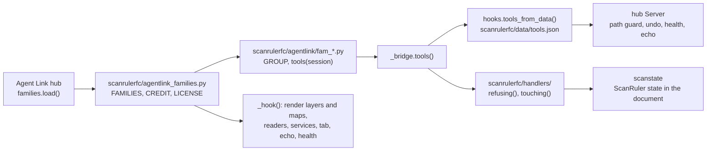

# How ScanRuler for FreeCAD plugs into Agent Link
<!-- SPDX-License-Identifier: AGPL-3.0-only -->

ScanRuler for FreeCAD is **ScanRuler by Stefan Hermann (CNC Kitchen)**, ported to FreeCAD (https://github.com/CNCKitchen/ScanRuler; see [NOTICE.md](../../NOTICE.md)). Its licence is AGPL-3.0-only, the same as ScanRuler.
This page tells how its tools reach the agent through Agent Link for FreeCAD (the hub). The hub's own flow is in [the hub's workflow pages](https://github.com/jamesK1000011/AgentLink-FreeCAD/blob/main/docs/workflow/README.md).

## How the hub finds it

- The hub loads any package on FreeCAD's path that holds `agentlink_families.py`. Here that is `scanrulerfc/agentlink_families.py`. The hub never names this add-on.
- Only `scanrulerfc/agentlink_families.py` and `scanrulerfc/agentlink/` import Agent Link. Without Agent Link, they are never imported, and the workbench works alone.
- `CREDIT` (`scanrulerfc.CREDIT`) and `LICENSE` (`AGPL-3.0-only`) show where its tools load.

## Its tools

- The tools are data: `scanrulerfc/data/tools.json`, in the hub's tool data format.
- Each family module in `scanrulerfc/agentlink/` (`fam_scan.py`, `fam_deviation.py` and the others in `NAMES`) has `GROUP`, `INFO` and `tools(session)`.
- `tools()` calls `_bridge.tools(group, handlers, session)`. That calls the hub's `hooks.tools_from_data()`. It binds each entry to its handler in `scanrulerfc/handlers/`.
- `_bridge.refusing()` turns ScanRuler's `errors.ToolError` into the hub's `ToolError`, with the same code and words.
- `_bridge.touching()` runs `scanstate.before()` and `scanstate.touched()` round each call. So the ScanRuler panel follows the agent's calls.
- A family that fails to load is left out (`SKIPPED`). The others still load.

## Its groups

`scan`, `elements`, `align`, `dimensions`, `sections`, `meshtools`, `flat`, `deviation`, `thickness`, `scan-noise`, `scan-thread`, `wear`, `catalog`, `manual`, `pack`, `fit-scan`, `scan-cad`, `snapshot`, `reverse`.
No group is in the lean list. The agent finds a tool with `tool_find` and calls it by name.

## What it reads and writes

- **Reads.** Scan meshes and images that the agent names (`scan_open`, `flat_open_image` and others). `.scanruler` projects from the original app. The FreeCAD document. Each path goes through the hub's path guard first.
- **Writes, in files.** The tools that have `writes: true` in `tools.json` write their `path`: `deviation_export`, `export_csv`, `fit_scan_export`, `flat_export`, `flat_render`, `manual_render`, `mesh_export`, `pack_write`, `scan_cloud`, `scan_heightmap`, `wear_prewarp`, `wear_rebuild`. The hub checks these paths as writes.
- **Writes, in the document.** ScanRuler's state (the scan, its alignment, elements, dimensions, sections and results) goes into the FreeCAD document, in a hidden "ScanRuler state" object. `own_state()` tells the hub that ScanRuler keeps this state per document itself (`hooks.own_document_state()`).
- **Heavy tools.** The tools with `heavy: true` (for example `deviation_measure`, `thickness_measure`, `mesh_wrap`) go to the hub's heavy queue. A long read can run as a job.

## Other hooks

Each hook is tried on its own. A hook that this hub lacks is skipped (`_hook()`), and the tools still load.

- Pictures: `render.register_layer()` for the scan and the reference, `render.register_map()` for the deviation and thickness maps.
- Readers: `hooks.register_reader("wall", …)` for the hub's printability check, `hooks.register_reader("thread_scan", …)` for a scanned thread.
- Services: `hooks.provide()` for `manual_maker`, `notice` and `library_pack`.
- The panel: the ScanRuler dock as a tab of the Agent Link panel.
- The echo: `echo.declare()` with the workbench, the keys and the words for each tool.
- Health: `health.register("scanruler_reverse", …)` puts the Reverse engineer's failed features into the hub's health check.

## Approvals

ScanRuler's tools ask for no approval. They run no code from outside and send nothing to a printer.

## Diagram

